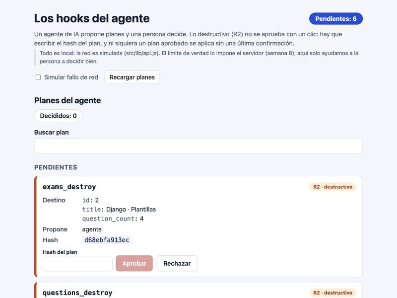
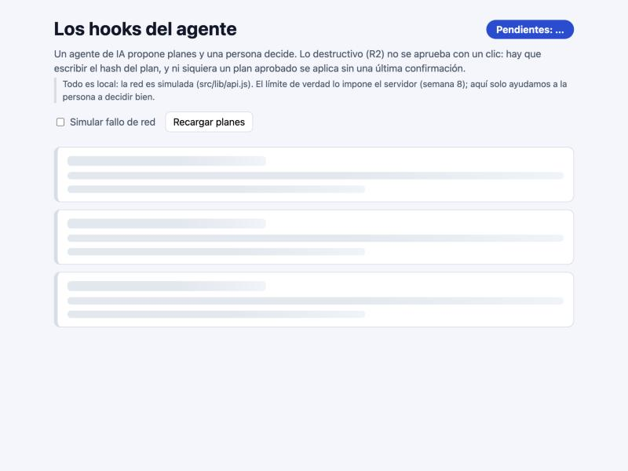
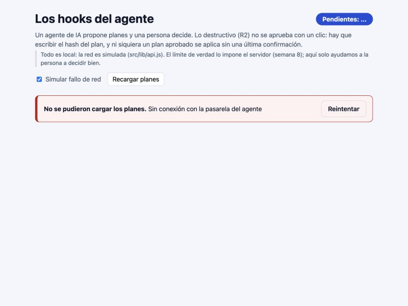
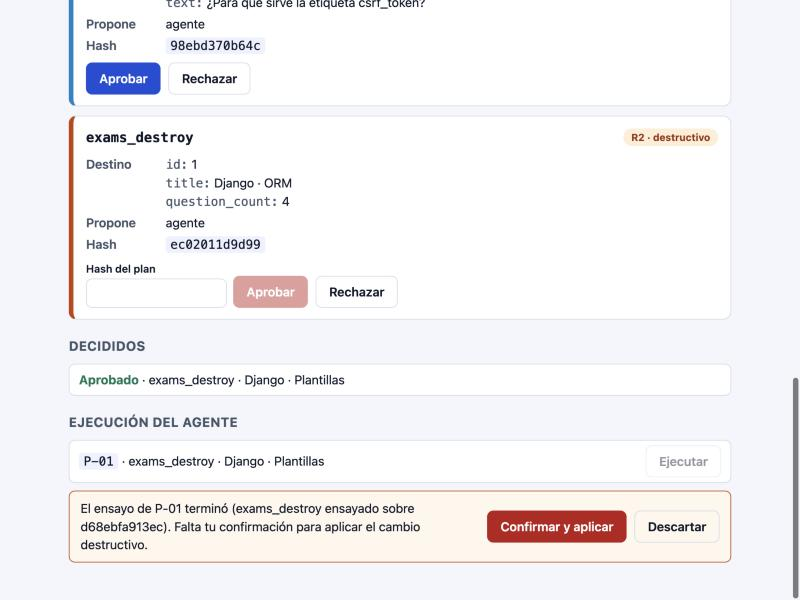
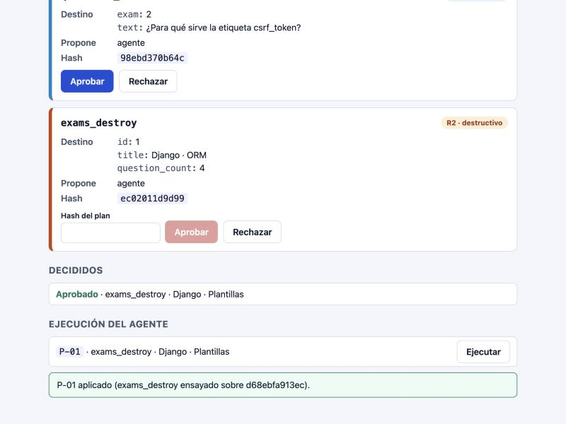
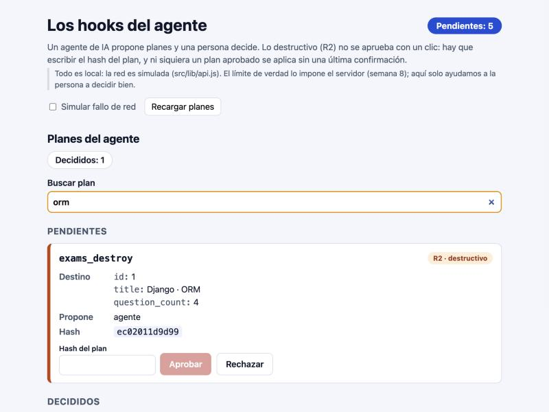

# Laboratorio extra S11 · Los hooks del agente

**Alumno:** Guillermo Willard · **Curso:** Desarrollo de Aplicaciones Empresariales · **Semana:** 11 · **Docente:** Michael Montgomery Rosell

**Repositorio del equipo:** https://github.com/willardguillermo/lab11-extra-empresariales

**Plantilla de partida:** https://github.com/Hellscythe25/dae-s11-hooks-del-agente

## 1. Resumen

Se completaron los tres hooks propios de `src/hooks` (`useDebounce`, `usePlans` y `useAgentRun`) contra sus pruebas y se revisaron los tres hooks «escritos por una IA» de `src/ai`: se encontraron, clasificaron y arreglaron sus **6 fallos**, uno por commit. Resultado final: `npm test` **57/57** y `npm run test:ai` **57/57**; `npm run build` compila sin errores.

El estado original de la versión de la IA quedó guardado antes de arreglarla en el commit `e72a60b` (etiqueta `ia-original`), con la salida de las pruebas en `docs/evidencias/00-ia-original.txt` (20 en rojo).

**Nota de entorno.** Con Node 26 el `localStorage` propio de Node tapa al de jsdom y las 57 pruebas fallan en `src/test/setup.js` antes de llegar a los hooks. Como el contrato (`AGENTS.md`) prohíbe tocar `package.json` y las pruebas, se corrió con `NODE_OPTIONS=--no-experimental-webstorage` (con Node 20 o 22 no hace falta).

## 2. Commits del trabajo

| Commit | Qué hace |
|---|---|
| `e72a60b` | Guarda el estado original de `src/ai` (20 en rojo) y el conteo inicial. Etiqueta `ia-original` |
| `aae10bc` | Parte 1: `useDebounce` |
| `8d35bf0` | Parte 2: `usePlans` |
| `db90495` | Parte 3: `useAgentRun` |
| `f9ee57a` | IA fallo 1: `useDebounce` no cancela el temporizador anterior |
| `da86e83` | IA fallo 2: `usePlans` se traga el error |
| `743c8f5` | IA fallo 3: `usePlans` no ignora la respuesta vieja |
| `ec85369` | IA fallo 4: `useAgentRun` rompe las reglas de los hooks |
| `aefeba6` | IA fallo 5: `useAgentRun` aplica un R2 sin aprobación |
| `3fb2d1e` | IA fallo 6: `useAgentRun` no aborta al desmontar |

## 3. Conteo de pruebas antes y después de cada arreglo

Comandos: `npm test` (tu código, `src/hooks`) y `npm run test:ai` (los hooks de la IA, `src/ai`). Total: 57 pruebas.

| Paso | `npm test` (src/hooks) | `npm run test:ai` (src/ai) |
|---|---|---|
| 0 · Estado inicial | 40 fallan · 17 pasan | 20 fallan · 37 pasan |
| 1 · Parte 1 `useDebounce` | 34 fallan · 23 pasan | 20 fallan · 37 pasan |
| 2 · Parte 2 `usePlans` | 18 fallan · 39 pasan | 20 fallan · 37 pasan |
| 3 · Parte 3 `useAgentRun` | 0 fallan · 57 pasan | 20 fallan · 37 pasan |
| 4 · IA fallo 1 (`useDebounce`) | 0 · 57 | 15 fallan · 42 pasan |
| 5 · IA fallo 2 (`usePlans`, error) | 0 · 57 | 13 fallan · 44 pasan |
| 6 · IA fallo 3 (`usePlans`, carrera) | 0 · 57 | 9 fallan · 48 pasan |
| 7 · IA fallo 4 (`useAgentRun`, reglas) | 0 · 57 | 8 fallan · 49 pasan |
| 8 · IA fallo 5 (`useAgentRun`, R2) | 0 · 57 | 1 falla · 56 pasan |
| 9 · IA fallo 6 (`useAgentRun`, desmontar) | 0 · 57 | 0 fallan · 57 pasan |

La salida completa de cada corrida está en `docs/evidencias/` (`00-*.txt` a `04-ia-fallo6.txt`).

## 4. Hooks propios: qué lógica se extrajo y quién la comparte

| Hook | Lógica con estado que encierra | Componentes que lo usan |
|---|---|---|
| `useDebounce(value, delay)` | Un estado con el último valor «tranquilo» y un `setTimeout` que se cancela en la limpieza del efecto en cada cambio y al desmontar | `Inbox` (buscador). Es genérico: cualquier buscador o campo que dispare trabajo lo reutiliza sin copiar el temporizador |
| `usePlans(fetchPlans)` | Los tres estados de una petición (`loading`, `ready`, `error`), `reload()` con identidad estable y la bandera `cancelled` que ignora la respuesta vieja | `App` (que pasa `status`, `plans` y `error` a `PlansSkeleton`, `ErrorBanner` e `Inbox`) |
| `useAgentRun(runAgent)` | La máquina de estados `idle → running → (awaiting_approval) → done / error`, el `AbortController` de la ejecución y la barrera R2 | `RunPanel` |

Con los hooks, los componentes quedan limpios: `Inbox` no sabe de temporizadores, `App` no sabe de banderas de cancelación y `RunPanel` solo dibuja el `status`. Decisión propia en `useAgentRun`: solo un plan **R1** va directo a `done`; cualquier otro riesgo (R2 o uno desconocido) espera `approve()`, para que un dato mal formado nunca salte la barrera.

## 5. Los 6 fallos de la IA, clasificados con evidencia

| # | Hook | Fallo | Categoría | Evidencia (antes del arreglo) |
|---|---|---|---|---|
| 1 | `useDebounce` | El `useEffect` abre un `setTimeout` en cada cambio pero no lo limpia; solo un segundo efecto limpia el **último** al desmontar | Efecto sin limpieza | `expected 'b' to be 'a'` (el valor intermedio se devuelve) y `expected 2 to be +0` (temporizadores vivos al desmontar) |
| 2 | `usePlans` | El `.catch` solo hace `console.error`: el estado se queda en `loading` para siempre | Falta un estado (error) | `expected 'loading' to be 'error'`; en `App`, `Unable to find ... role "alert"` |
| 3 | `usePlans` | Sin bandera `cancelled`: una respuesta lenta anterior pisa la nueva (también con StrictMode y al cambiar `fetchPlans`) | Carrera de peticiones | Fallan las 3 pruebas de «ignora la respuesta vieja» |
| 4 | `useAgentRun` | `if (!runAgent) return ...` **antes** de `useRef` y `useCallback`: cuando `runAgent` aparece cambia el número de hooks | Reglas de los hooks | `Error: Rendered more hooks than during the previous render.` |
| 5 | `useAgentRun` | Al terminar bien siempre pasa a `done`: un plan R2 se aplica sin `approve()` | Seguridad (barrera R2) | `expected 'done' to be 'awaiting_approval'`; en `Inbox`, `Unable to find ... /Falta tu confirmación/` |
| 6 | `useAgentRun` | No hay `useEffect` que aborte el `AbortController` al desmontar | Efecto sin limpieza (desmontar) | `al desmontar con una ejecución en curso aborta su señal`: `expected false to be true` |

## 6. Las cuatro preguntas de revisión del diff, por cada hook

Preguntas de `AGENTS.md`: **P1** ¿hooks en el mismo orden y en el nivel superior?; **P2** ¿todo `useEffect` que abre algo lo limpia al repetirse y al desmontar?; **P3** ¿se resuelven y se ven los tres estados?; **P4** ¿el dato vive en el ancestro más bajo que lo necesita?

### 6.1 `useDebounce`

| Pregunta | Versión de la IA (antes) | Después del arreglo |
|---|---|---|
| P1 Orden de los hooks | Sí: `useState`, `useRef` y dos `useEffect`, sin condiciones | Sí: `useState` y un `useEffect` |
| P2 Limpieza | **No.** El efecto de `[value, delay]` no devuelve limpieza; los temporizadores se acumulan. Prueba: «tres cambios seguidos devuelven solo el último» falla | Sí: `return () => clearTimeout(timer)` corre antes de repetir y al desmontar |
| P3 Tres estados | No aplica (no hace peticiones) | No aplica |
| P4 Dónde vive el dato | Sí: el texto escrito y el valor tranquilo viven en `Inbox`, el único que los usa | Sí, sin cambios |

### 6.2 `usePlans`

| Pregunta | Versión de la IA (antes) | Después del arreglo |
|---|---|---|
| P1 Orden de los hooks | Sí: cuatro `useState`, un `useEffect` y un `useCallback`, siempre en el mismo orden | Sí |
| P2 Limpieza | **No.** El efecto abre una petición y no devuelve limpieza: la respuesta vieja pisa la nueva y llega tras desmontar | Sí: la limpieza pone `cancelled = true` y los dos caminos lo comprueban |
| P3 Tres estados | **No.** El error nunca se guarda: la pantalla se queda en el esqueleto | Sí: `loading` (esqueleto), `ready` (bandeja) y `error` (aviso con «Reintentar»). Ver capturas 06 y 07 |
| P4 Dónde vive el dato | Sí: los planes se cargan en `App`, que es el ancestro común de `Header` (contador) e `Inbox` (lista) | Sí, sin cambios |

### 6.3 `useAgentRun`

| Pregunta | Versión de la IA (antes) | Después del arreglo |
|---|---|---|
| P1 Orden de los hooks | **No.** Hay un `return` antes de `useRef`/`useCallback`. Prueba: `Rendered more hooks than during the previous render` | Sí: todos los hooks arriba; la falta de `runAgent` se resuelve dentro de `start()` |
| P2 Limpieza | **No.** La petición del agente no se aborta al desmontar | Sí: `useEffect(() => () => controller.current?.abort(), [])` |
| P3 Estados | **No.** Un R2 nunca pasa por `awaiting_approval` (que es la confirmación que la persona ve) | Sí: `running`, `awaiting_approval`, `done` y `error` se ven en `RunPanel`. Ver capturas 08 y 09 |
| P4 Dónde vive el dato | Sí: la ejecución vive en `RunPanel`, el único que la muestra; no se subió a `App` «por si acaso» | Sí, sin cambios |

## 7. Árbol de componentes y el dato de cada nivel

```
App                       usePlans → status, plans, error, reload
│                         decisions { planId: "approved" | "rejected" }  (+ localStorage)
│                         failing (simular fallo de red)
│                         pendingCount = derivado de plans + decisions (no se guarda)
├── Header                recibe solo pendingCount (un número)
├── PlansSkeleton         (sin datos; se ve mientras status = "loading")
├── ErrorBanner           recibe error y onRetry = reload   (status = "error")
└── Inbox                 recibe plans, decisions, onDecide, runAgent
    │                     query (texto escrito) + useDebounce → quietQuery
    │                     pending, decided, approved, visible = derivados
    ├── PlanCard × n      recibe plan y onDecide
    │   └── HashConfirm   el hash escrito (estado local de la tarjeta R2)
    └── RunPanel          recibe approvedPlans y runAgent
                          useAgentRun → status, plan, result, error
```

**Por qué el contador de pendientes vive en `App` y no en la cabecera.** El contador se calcula con dos datos: la lista de planes (`usePlans`, en `App`) y las decisiones (`decisions`). Las decisiones las **cambia** `Inbox` (al aprobar o rechazar en una tarjeta) y las **lee** `Header` (para contar). `Header` e `Inbox` son hermanos: ninguno puede ver el estado del otro. El ancestro común más bajo de los dos es `App`, así que ahí vive el estado y el contador se deriva en cada dibujado. Si el contador viviera en `Header`, `Inbox` no tendría forma de avisarle de una decisión sin duplicar el estado (dos fuentes de verdad que se desincronizan). Además, `Header` recibe **solo el número**, no la lista: no necesita los planes y no se tiene que volver a dibujar por ellos.

## 8. Por qué esta interfaz no es la frontera de seguridad

La barrera del R2 (escribir el hash exacto, y después «Confirmar y aplicar» en `awaiting_approval`) vive en el **navegador**, y todo lo que corre en el navegador lo controla quien lo usa:

- Cualquiera puede abrir las herramientas del desarrollador y cambiar el estado de React, el `localStorage` o el propio JavaScript, o llamar a `runAgent` directamente sin pasar por `approve()`.
- Cualquiera puede saltarse la página entera y enviar la petición a la API con `curl` o Postman.
- El arreglo del fallo 5 hace que **nuestra** interfaz no aplique un R2 sin confirmación, pero no impide que otro cliente lo haga.

Por eso la frontera de verdad es el **servidor** (la pasarela de la semana 8): es quien debe verificar que el `plan_hash` coincide, que el usuario tiene permiso y que un R2 lleva una aprobación humana registrada, y rechazar todo lo demás. La interfaz solo **ayuda a la persona a decidir bien** (lo dice la propia cabecera de la app); es una capa de experiencia de usuario y de prevención de errores, no de control de acceso.

## 9. Capturas de la aplicación

Capturas tomadas con `npm run dev` corriendo (en `docs/evidencias/`).













## 10. Tabla de uso de IA

Herramienta: **Claude Code** (agente con acceso al repositorio, modelo Claude Opus 5.5), con `AGENTS.md` como contrato. Cada fila es un pedido o un turno del agente.

| # | Qué se pidió | Qué respondió | ¿Aceptado? | Por qué | Evidencia (comando y salida) |
|---|---|---|---|---|---|
| 1 | Desarrollar el laboratorio extra completo a partir de la guía y la plantilla, con commits por paso | Clonó la plantilla, corrió las pruebas y detectó que con Node 26 fallaban las 57 | Aceptado | El diagnóstico se comprobó: el error está en `setup.js` (`localStorage.clear` sobre `undefined`), no en los hooks | `npm test` → `57 failed`; con `NODE_OPTIONS=--no-experimental-webstorage` → `40 failed / 17 passed` (lo que dice el README) |
| 2 | (Propuesta del propio agente) arreglar el entorno cambiando el script `test` de `package.json` | Diff que añade `NODE_OPTIONS=...` al script | **Rechazado** | `AGENTS.md` prohíbe tocar `package.json`; además `VAR=valor comando` no funciona en PowerShell, que es el entorno del curso | Ver diff del rechazo en la sección 11. Se usó la variable de entorno solo en la terminal |
| 3 | Parte 1: escribir `useDebounce` | Estado + `setTimeout` con `clearTimeout` en la limpieza | Aceptado | Pasa las 4 preguntas del diff y sus pruebas | `npm test -- useDebounce` → `10 passed (10)`; total `34 failed / 23 passed` |
| 4 | Parte 2: escribir `usePlans` | Un estado `{status, plans, error}`, contador `attempt`, bandera `cancelled` | Aceptado | Resuelve los tres estados e ignora la respuesta vieja | `npm test -- usePlans` → `12 passed (12)`; total `18 failed / 39 passed` |
| 5 | Parte 3: escribir `useAgentRun` | Máquina de estados con `useRef` para el estado y el `AbortController`; solo R1 va a `done` | Aceptado | Todos los hooks arriba; limpieza al desmontar; barrera R2 | `npm test -- useAgentRun` → `18 passed (18)`; total `57 passed (57)`; `npm run build` → `built` |
| 6 | Parte 4: revisar `src/ai/useDebounce.js` | El código de la IA no limpia el temporizador en cada repetición | **Rechazado** (se arregló) | Falla P2; deja pasar valores intermedios | `npm run test:ai` 20 → 15 fallos (commit `f9ee57a`) |
| 7 | Parte 4: revisar `src/ai/usePlans.js` (error) | El `.catch` de la IA solo hace `console.error` | **Rechazado** (se arregló) | Falla P3: la pantalla se queda cargando | `npm run test:ai` 15 → 13 fallos (commit `da86e83`) |
| 8 | Parte 4: revisar `src/ai/usePlans.js` (carrera) | Sin bandera `cancelled` | **Rechazado** (se arregló) | Falla P2: la respuesta vieja pisa la nueva | `npm run test:ai` 13 → 9 fallos (commit `743c8f5`) |
| 9 | Parte 4: revisar `src/ai/useAgentRun.js` (reglas) | `return` antes de los hooks | **Rechazado** (se arregló) | Falla P1 | `Rendered more hooks...`; `npm run test:ai` 9 → 8 (commit `ec85369`) |
| 10 | Parte 4: revisar `src/ai/useAgentRun.js` (R2) | Siempre pasa a `done` | **Rechazado** (se arregló) | Rompe la regla de seguridad R2 | `expected 'done' to be 'awaiting_approval'`; `npm run test:ai` 8 → 1 (commit `aefeba6`) |
| 11 | Parte 4: revisar `src/ai/useAgentRun.js` (desmontar) | No aborta al desmontar | **Rechazado** (se arregló) | Falla P2 | `npm run test:ai` 1 → 0, `57 passed (57)` (commit `3fb2d1e`) |
| 12 | Comprobar la app en el navegador | Recorrió carga, error, Reintentar, aprobación R2, confirmación y buscador | Aceptado | Se ven los tres estados y la barrera R2; consola sin errores | Capturas 05 a 10 |
| 13 | Redactar el entregable y subir el proyecto al repositorio del equipo | Este documento y `git push` a `willardguillermo/lab11-extra-empresariales` | Aceptado | Se comprobó que el push llegó al repositorio y que las dos suites siguen en verde | `git push` y `npm test` / `npm run test:ai` → `57 passed (57)` |

## 11. Diff de los rechazos

**Rechazo de la propuesta del agente (fila 2)**: no se aplicó.

```diff
--- a/package.json
+++ b/package.json
@@ "scripts": {
     "dev": "vite",
     "build": "vite build",
-    "test": "vitest run --mode team",
-    "test:ai": "vitest run --mode ai",
+    "test": "NODE_OPTIONS=--no-experimental-webstorage vitest run --mode team",
+    "test:ai": "NODE_OPTIONS=--no-experimental-webstorage vitest run --mode ai",
```

**Rechazo del código de la IA (filas 9 a 11)**: `git diff ia-original HEAD -- src/ai/useAgentRun.js`

```diff
-import { useCallback, useRef, useState } from "react";
+import { useCallback, useEffect, useRef, useState } from "react";
@@ export default function useAgentRun(runAgent) {
   const [run, setRun] = useState(IDLE);
-
-  if (!runAgent) {
-    return { ...IDLE, start: () => {}, approve: () => {}, reject: () => {} };
-  }
-
+  // FIX 4: no early return before the hooks. Every hook runs on every render in the same order;
+  // a missing runAgent is handled inside start() instead.
   const latest = useRef(IDLE);
   const controller = useRef(null);
@@
+  // FIX 6: on unmount, abort the run in progress so its late answer never touches the state.
+  useEffect(() => {
+    return () => controller.current?.abort();
+  }, []);
+
   const start = useCallback(
     (plan) => {
+      if (!runAgent) return;
@@
-          update({ status: "done", plan, result, error: null });
+          // FIX 5: an R2 plan never goes from running to done; it waits for approve().
+          const status = plan.risk === "R1" ? "done" : "awaiting_approval";
+          update({ status, plan, result, error: null });
```

## 12. Conclusiones

- Un hook propio encierra lógica con estado que de otro modo se repetiría en cada componente (temporizadores, peticiones, máquinas de estado) y deja el componente limpio: solo dibuja lo que el hook devuelve.
- Todo `useEffect` que abre algo debe cerrarlo en su limpieza; 3 de los 6 fallos de la IA eran exactamente eso, y ninguno se nota a simple vista: solo las pruebas con relojes falsos y promesas controladas los revelan.
- Un código que «se ve bien y compila» puede romper una regla de seguridad (el R2 aplicado sin confirmar). Por eso el agente propone y las **pruebas y las personas deciden**, y la frontera real de seguridad está en el servidor, no en la interfaz.
- El estado se sube al ancestro común más bajo que lo necesita (`App` para las decisiones; `RunPanel` para la ejecución), ni más arriba ni más abajo.
